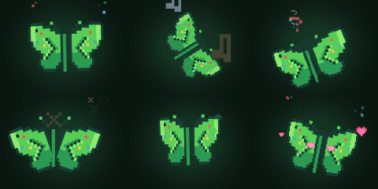
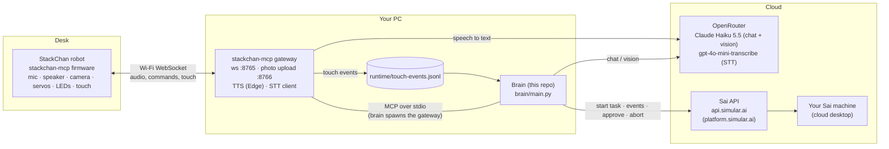
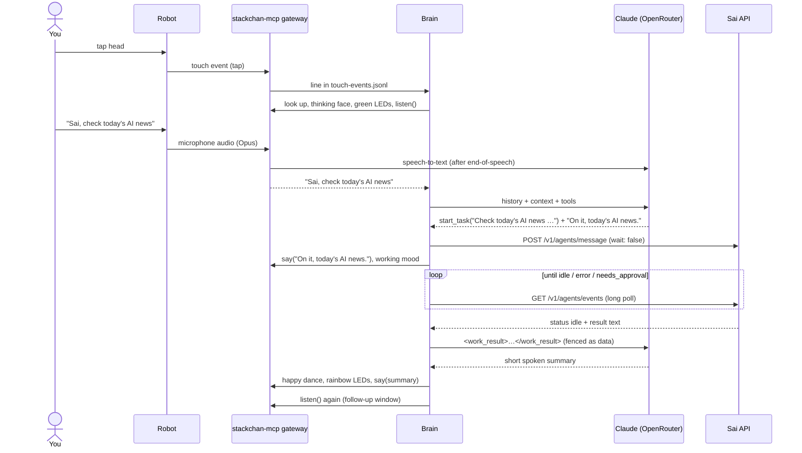
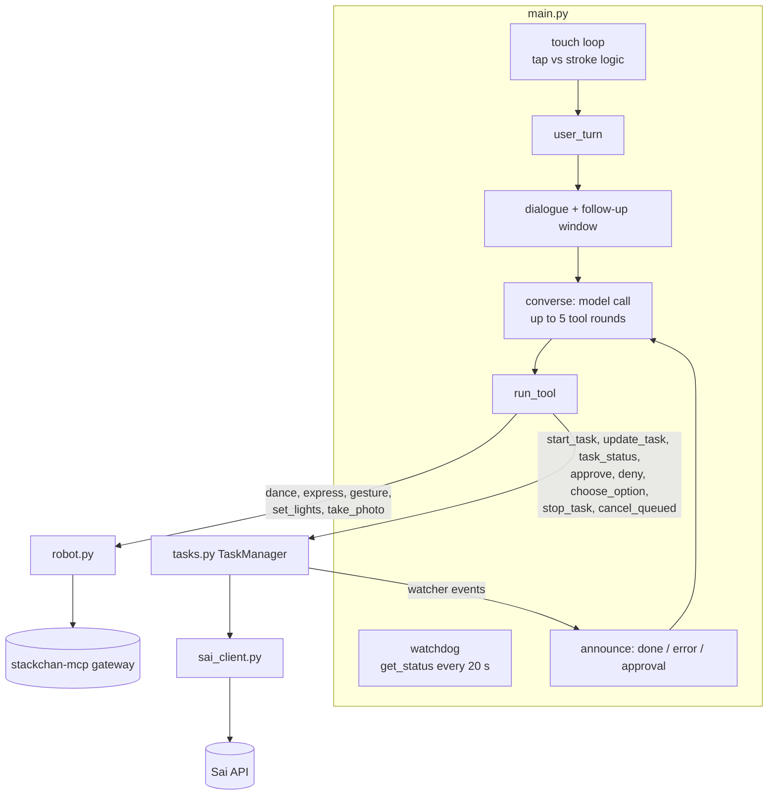

# Sai desk robot: a StackChan you talk to that does real work on a computer

Tap the robot's head and talk to it. It answers small talk itself. When you ask for real work, like "find me a ride to
the airport at 6", "email this photo to me" or "check the AI news", it hands the job to **Sai**, Simular's computer-use
agent, through the **[Sai API on platform.simular.ai](https://platform.simular.ai)**. Sai does the job on a real
desktop (browser, apps, files, email). The robot shows its mood on its face, LEDs and head while Sai works. It asks you
out loud when Sai needs your okay, and celebrates when the job is done.



- **Hardware:** an [M5Stack StackChan](https://github.com/m5stack/StackChan) (CoreS3, ESP32-S3, two servos, camera,
  mic, speaker, 12 LEDs, touch-sensitive head).
- **Robot software:** the [stackchan-mcp](https://github.com/kisaragi-mochi/stackchan-mcp) firmware and gateway, which
  turn the robot into a set of MCP tools on your PC.
- **Brain:** a small Python program in this repo. It runs on the PC, holds the conversation and drives the robot.
- **Work:** the [Sai API](https://platform.simular.ai) (`https://api.simular.ai`). Any task that needs a computer is
  sent there.

> Status: a working personal build, used every day on one robot with Windows 11. Expect to adjust things for your
> setup. The scripts for running it in the background are Windows-only. The brain itself is plain Python.

---

## How it works

### The big picture



The design is **"a small AI in front, Sai for jobs"**:

- A fast, cheap conversation model (Claude Haiku 5.5 via OpenRouter) talks with you, controls the body and decides when
  something is a job.
- The **Sai API is used only for jobs.** Each job becomes a Sai task. The brain follows the task's events in the
  background and speaks up only when there is something to say: the task is done, failed, or needs approval.
- Everything secret stays on the PC. The robot never sees an API key. It only knows the gateway's address and a shared
  token.

### One conversation, step by step



### What the robot does, and when

| Event | Face | Lights and head | Speech |
|---|---|---|---|
| Tap the head | thinking | looks up, green LEDs, starts listening | – |
| Stroke the head | shy (blush and hearts) | turns away and peeks, pink heartbeat | "Hehe." / "That tickles!" |
| You ask for a job | thinking | slow breathing lights while Sai works | one short acknowledgement that repeats the key detail |
| Sai needs your okay | surprised | jolt and double-take, white then amber | asks once in plain words, then listens |
| Job done | happy (dance twirl) | happy hops and a rainbow spin | short summary of the real result |
| Job failed | sad | head droops, "tears" lights | says what went wrong |
| "Dance for me" | happy | dance routine with rainbow lights | a few words |
| "What am I holding?" | – | head centres, white LED flash, photo | describes what it sees |

After every reply the robot keeps listening for a few seconds, up to 4 times, so you can follow up without tapping
again. If you stay quiet, it goes back to idle. The head never moves on its own while idle. Only the face animates.

---

## Repository layout

```
brain/                    the brain (uv project, Python 3.12)
  main.py                 Brain: touch handling, conversation loop, tool dispatch, task announcements, watchdog
  robot.py                Robot: MCP client for the gateway; speech, listening, camera, face animation,
                          head/LED performances (PERFORMANCES), touch-event reader
  prompt.py               System prompt and tool schemas for the conversation model
  tasks.py                TaskManager: one running Sai task + local queue, approvals, choices, stop, event watcher
  sai_client.py           Minimal async client for the Sai API
  config.py               Settings from .env and the environment
tools/
  patch_gateway.py        Idempotent fixes to the installed stackchan-mcp 0.20.0 gateway (see below)
  gateway_check.py        Test client: device status, set URL/token/volume, test touch, listen, say
face/
  build_sai_face.py       Builds the custom face set (Playwright + Pillow)
  sai_face_matrix.rgb565  The built face set: 90 frames, 160x120 RGB565 (stackchan-mcp "matrix" format)
  sai_face_timing.json    Animation speed per face
docs/                     preview images
run_sai.ps1               Keeper: runs the brain and restarts it 10 s after any exit (single instance)
start_sai_hidden.vbs      Starts the keeper with no window
install_autostart.ps1     Registers a Windows scheduled task that starts Sai at logon
Start Sai.cmd / Stop Sai.cmd
.env.example              Settings template
```

### Inside the brain



**main.py: the Brain**

- **Touch.** The head pad often confuses taps and strokes, so the brain cleans up its events:
  - A tap is confirmed only after 0.6 s with no second tap or stroke. Two quick taps count as a stroke.
  - Taps up to 1.5 s after a stroke are ignored (the finger lifting off).
  - Touches are ignored while the head is moving.
  - A tap made while the robot is busy is remembered for up to 8 s.
- **Conversation.**
  - Every turn sends the model a `<context>` block with the local time and the state of any work.
  - The history (last 40 messages) is saved to `runtime/conversation.json`, so the robot remembers across restarts.
- **Announcements.**
  - When a task finishes, fails or asks for approval, the brain passes the event to the model fenced as data
    (`<work_result>` / `<approval_request>`), so text from web pages can't give it orders.
  - The model turns the event into one short spoken line, and the brain then listens for your answer.
- **Watchdog.**
  - If the gateway stops answering, the brain exits and the keeper restarts it.
  - When the robot comes back online, it says "I'm back" and reloads its face. The robot forgets the custom face when
    it reboots.

**tasks.py: talking to Sai**

- **One task at a time.** A second request waits in a local queue and starts when the first finishes. It is never
  folded into the running task: then one abort would kill both.
- **`update_task`** sends a correction ("actually make it AI news") into the running task.
- **Approvals** are answered with `approve`, `deny` or, for multiple-choice questions, `choose_option`. A spoken
  choice must exactly match one of the offered option values. Sign-ins can't be approved by voice: they go to the Sai
  app.
- **`stop_task`** stops either everything or only the running task.

**prompt.py: the persona.** The rules are adapted from Simular's [sai-fi](https://github.com/simular-ai/sai-fi) voice
client. Each rule there fixed a problem heard on a real device:

- Speak in the first person: "I'm on it", never "Sai is doing it".
- Answer in one short sentence, with no markdown, because everything is spoken aloud.
- Acknowledge a job once and repeat the key detail, so a mishearing shows up right away.
- Never ask "are you sure?" on top of Sai's own approvals.
- Never claim a job is done until a real result says so.
- Use the camera only when asked.
- Reply in English only. A transcript in another language means the transcriber misheard.

---

## The Sai API (platform.simular.ai)

All computer work goes through the **[Sai API](https://platform.simular.ai)**. The API reference for agents is at
[platform.simular.ai/documentation/llms.txt](https://platform.simular.ai/documentation/llms.txt). Create an API key
on platform.simular.ai and put it in `.env` as `SAI_API_KEY`.

The brain uses these endpoints (`brain/sai_client.py`, Bearer auth, base `https://api.simular.ai`):

| Call | Used for |
|---|---|
| `GET /v1/agents/auth` | check the key at startup |
| `GET /v1/agents/machines` | list your Sai machines; set `SAI_MACHINE_ID` to choose one |
| `POST /v1/agents/message` `{message, wait: false, machineId?, attachments?}` | start a task without blocking. Returns `sessionId`. If a task is already running, the message joins that task (`queued: true`), which is how `update_task` works |
| `GET /v1/agents/events?sessionId&since&wait=30` | long-poll progress: `data-progress` steps, then `status` `idle` (done, with `text`), `error` or `needs_approval` (with `approval`) |
| `POST /v1/agents/approve` `{approvalId, response: yes / no / task, selections?}` | answer an approval or a multiple-choice question |
| `POST /v1/agents/abort` `{machineId}` | stop the running task |
| `POST /v1/agents/upload` (raw body, `x-filename` header) | upload the camera photo; the returned object goes in `attachments` |

Two Sai features fit a voice robot especially well:

- **Approvals.** Sai pauses before risky steps. The robot asks you out loud and answers with your "yes" or "no".
- **Replayable skills.** Ask Sai, by voice, to save a job you repeat as a skill. Next time it replays the skill much
  faster.

---

## Setup

You need: a StackChan (M5Stack CoreS3 version), a USB-C cable, a Windows PC on the same **2.4 GHz** Wi-Fi as the
robot, [uv](https://docs.astral.sh/uv/), ffmpeg, an [OpenRouter](https://openrouter.ai) key and a
[Sai API key](https://platform.simular.ai).

### 1. Back up the robot, then flash stackchan-mcp

Flashing wipes the robot's factory firmware, Wi-Fi settings and servo calibration. **Back up the whole flash first**,
and keep the backup private, because it contains your Wi-Fi password:

```powershell
uvx --from esptool esptool --port COM5 -b 921600 read-flash 0 0x1000000 backup\stackchan-factory-16MB.bin
```

Download `merged-binary.bin` from the
[stackchan-mcp releases](https://github.com/kisaragi-mochi/stackchan-mcp/releases) (this build used firmware v1.18.0)
and write it at address 0:

```powershell
uvx --from esptool esptool --chip esp32s3 --port COM5 -b 460800 write-flash 0x0 merged-binary.bin
```

To restore the factory firmware, write the backup back at 0x0.

**Before you flash, note your servo calibration.** stackchan-mcp assumes servo centres of 460 (yaw) and 620 (pitch).
The factory firmware stores the real centres in NVS (`servo` / `zero_pos_1`, `zero_pos_2`). Each degree is 3.2 servo
units. Put the difference in `.env`. For example, factory 476 / 601 gives `SAI_YAW_OFFSET=5` and `SAI_PITCH_OFFSET=-6`.

### 2. Wi-Fi

On the robot's welcome screen, join its setup hotspot (`Xiaozhi-xxxx`) with your phone, open `192.168.4.1` and choose
your 2.4 GHz Wi-Fi. That is the only step that needs a phone. On the PC, set that network to **Private**, so Windows
Firewall lets the robot reach the gateway.

### 3. Install the gateway and patch it

```powershell
uv tool install --python 3.12 "stackchan-mcp[tts,stt-faster-whisper,stt-openai]==0.20.0" --with edge-tts --with "av<15" --no-build-package av
uv tool install edge-tts
& "$env:APPDATA\uv\tools\stackchan-mcp\Scripts\python.exe" tools\patch_gateway.py
```

Three install details matter:

- `av<15` is required because PyAV 19 breaks faster-whisper.
- `--no-build-package av` avoids building PyAV from source, which needs MSVC.
- Run `patch_gateway.py` again after any reinstall. It is idempotent.

`patch_gateway.py` makes these changes to stackchan-mcp 0.20.0. Each fixes a problem found on the real robot:

1. **Speech prebuffer.** The robot's voice stuttered whenever the network jittered. The patch sends the first 0.72 s
   of audio at once, then paces the rest.
2. **Cloud speech-to-text format.** `gpt-4o-mini-transcribe` rejects `verbose_json`, so every listen came back empty.
   The patch asks for plain `json`.
3. **End-of-speech detection.** The gateway used to record for the full window. Now it stops 1.2 s after you stop
   talking, and gives up after 4 s of silence.
4. **Optional capture dump** for debugging listening (`SAI_SAVE_CAPTURES=1`).
5. **`language="auto"`** support.
6. **Skip the robot's own chime.** Each recording started with about 0.4 s of chime and servo noise. The transcriber
   turned it into Spanish or Chinese nonsense. The patch drops the first 480 ms.
7. **`vad` result.** The listen result now tells "nobody spoke" apart from "spoke but nothing was transcribed".

### 4. Settings

```powershell
copy .env.example .env   # then fill in SAI_API_KEY, OPENROUTER_API_KEY, STACKCHAN_TOKEN (any long random string)
```

### 5. Pin the robot to your PC

The robot can find the gateway by mDNS, but that was unreliable on some routers. Save the PC's address and the token
on the robot from the PC (no phone needed). Run each command with the gateway's Python:

```powershell
$py = "$env:APPDATA\uv\tools\stackchan-mcp\Scripts\python.exe"
& $py tools\gateway_check.py --set-url ws://<PC LAN IP>:8765/
& $py tools\gateway_check.py --set-token
& $py tools\gateway_check.py --use-token --act --volume 95   # nod, lights, speech
```

Reserve the PC's IP address in your router, so it doesn't change.

### 6. Run it

```powershell
cd brain
uv run python main.py
```

The robot loads its face and says hello. Tap its head and talk.

To run it in the background and start it at Windows logon:

```powershell
powershell -ExecutionPolicy Bypass -File install_autostart.ps1
```

Then use `Start Sai.cmd` / `Stop Sai.cmd`. **Run only one brain at a time.** Two brains fight over the robot. Logs go
to `runtime/`: `brain.log`, `gateway.log`, `keeper.log`.

---

## Changing the face

The face is Sai's green pixel butterfly. It comes from the "Saibot cast" design page
(`sai-design-prototype-olive.vercel.app/docs/saibot-cast/cast.html`). `face/build_sai_face.py` opens the page in
Edge with Playwright, pauses its animation clock, and captures each pose frame by frame. It fits the frames to the
160x120 screen and writes the stackchan-mcp **matrix** face set. The matrix has 90 frames: 6 faces x 3 eye states x 5
mouth/animation frames.

```powershell
cd face
uv run --no-project --with playwright --with pillow python build_sai_face.py
```

| Robot slot | Sai pose |
|---|---|
| idle | resting pose |
| happy | dance twirl |
| thinking | thinking |
| sad | error |
| surprised | excited pose (approval requests) |
| embarrassed | shy: tilted, blushing, with rising hearts |

The firmware has six face slots. The brain animates a face by cycling its five frames with `set_mouth_sequence`, and
cycles faster while the robot talks. To use your own character, replace the capture step with your own frames. Keep
the output format the same: 90 frames, RGB565 little-endian, frame index = face x 15 + eyes x 5 + frame.

---

## Privacy and safety

- API keys live only in `.env` on the PC, which is git-ignored. The robot only holds the gateway URL and a token.
- Text that comes back from Sai tasks is fenced as data in the prompt, never treated as instructions.
- The camera is used only when you ask. A photo is attached to a Sai task only when the task is about that photo.
- Recordings are not kept unless you set `SAI_SAVE_CAPTURES=1`. The conversation history is stored locally in
  `runtime/conversation.json`.
- stackchan-mcp firmware still checks for updates at its default address when it boots.

---

## Projects this is built on

These are the projects this build actually uses or copies from:

| Project | What it's used for |
|---|---|
| **[Sai API, platform.simular.ai](https://platform.simular.ai)** | **Does all the computer work: tasks, events, approvals, uploads** |
| **[kisaragi-mochi/stackchan-mcp](https://github.com/kisaragi-mochi/stackchan-mcp)** (MIT; the firmware binary is GPL-3.0 because of SCServo_lib) | **The robot firmware and the PC gateway. The whole body (voice, listening, camera, servos, LEDs, touch, custom face sets) is reached through its MCP tools. `tools/patch_gateway.py` patches its gateway.** |
| [simular-ai/sai-fi](https://github.com/simular-ai/sai-fi) (MIT) | The voice-client rules behind `prompt.py`, and the method for grouping spoken choices (`group_selections`) |
| [78/xiaozhi-esp32](https://github.com/78/xiaozhi-esp32) (MIT) | The ESP32 voice firmware that stackchan-mcp's firmware is forked from |
| [m5stack/StackChan](https://github.com/m5stack/StackChan) | The robot hardware and its factory firmware |
| [OpenRouter](https://openrouter.ai) | Claude Haiku 5.5 (chat and vision) and gpt-4o-mini-transcribe (speech-to-text) |
| [rany2/edge-tts](https://github.com/rany2/edge-tts) | The robot's voice (`en-US-AnaNeural`) |
| [espressif/esptool](https://github.com/espressif/esptool) | Backing up and flashing the robot |
| [Playwright](https://playwright.dev/python/) and [Pillow](https://python-pillow.org/) | Capturing and building the face |
| [MCP Python SDK](https://github.com/modelcontextprotocol/python-sdk) | The brain's client for the gateway |

## License

MIT, see [LICENSE](LICENSE). The Sai character art in `face/` and `docs/` belongs to Simular.
